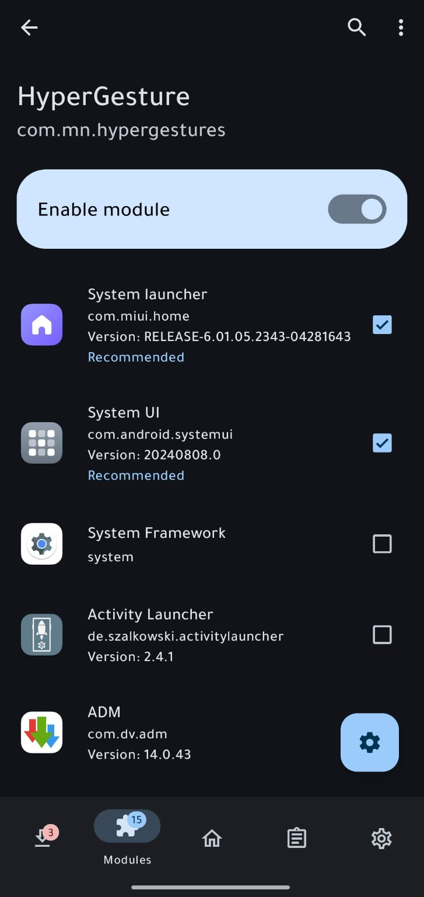

<p align="center"></p>
<h1 align="center">HyperGesture</h1>
<p align="center"><strong>Your launcher. Your gestures.</strong><br>Third-party launcher navigation for selected HyperOS 3 / Android 15 builds.</p>
<p align="center">   </p>

HyperGesture enables system navigation gestures with third-party launchers on supported HyperOS builds. Use your preferred launcher as the default Home app; Smart Launcher is a tested example, not a requirement. It targets the exact system packages listed below and includes a native English dashboard, illustrated setup guide, and automatic haptic feedback.

**Created for and maintained by Mohammad Alnashawati.**

## Features

| Gesture | Action |
| --- | --- |
| Swipe inward from either side edge | Go back (native system gesture) |
| Swipe up and release | Return to your default launcher |
| Swipe up, then pause | Open Recents |
| Swipe horizontally along the bottom | Return to the previous app; either direction performs the same switch |
| Press and hold the full-screen indicator | Preserve the system shortcut, including Circle to Search where available |

- Haptic feedback for Home, Recents and app-switch requests, enabled automatically with no in-app toggle. Android touch-feedback settings still apply.
- Home, Guide and About tabs, with direct shortcuts to system navigation and default-launcher settings.
- Explicit system-version checks and diagnostic logging.
- No replacement of system APKs and no global spoofing of your default launcher.

> This is not Xiaomi's interactive launcher animation system. Custom visual effects and the native-animation experiment are not included in 0.4.9. Circle to Search must already be supported by the device and its system services.

## Compatibility

| Component | Required version |
| --- | --- |
| Android | Android 15 / API 35 |
| Xiaomi System launcher | `com.miui.home` · versionCode `601052343` |
| System UI | `com.android.systemui` · versionCode `202408080` |
| Hook framework | LSPosed-compatible framework supporting legacy Xposed API 82 |

**Tested launcher:** Smart Launcher **6.6 build 024** (`ginlemon.flowerfree`), using the supplied HyperOS 3 system APKs. HyperGesture is designed for third-party launchers generally and does not restrict navigation to Smart Launcher. Other launchers may work, but have not all been tested. Matching version codes alone do not guarantee identical ROM behavior.

**Root and a working hooking framework are required.** MiuiHome must remain installed and enabled because it provides the gesture and Recents infrastructure.

## In-app updates

HyperGesture includes GitHub update checks, optional notifications, verified APK downloads and user-confirmed installation. No custom server or GitHub token is required. This public repository contains both the complete app source and official signed releases.

A green download icon appears beside the version in the header only when a newer release is known. Tap it to download and install from a compact dialog. Tap the version to check manually. Home and About have no update section or notification-settings button. Android requests notification permission once at first launch if it is not already granted. Denying it does not prevent manual updates.

The app checks on opening and approximately every 12 hours in the background, subject to Android scheduling. Downloads start only when requested; keep the app open. Reboot after installation.

Maintainers: [publish an update](docs/UPDATES.md), [release-notes template](release/RELEASE_TEMPLATE.md), [metadata generator](scripts/prepare_release.py). Upload both the signed APK and generated `update.json` to each stable release.

## Installation

1. Download the signed APK from [GitHub Releases](https://github.com/Mnshawaty/HyperGesture-Releases/releases), or build it locally using the instructions below.
2. Enable **HyperGesture** in LSPosed/Vector.
3. Select only **System launcher** (`com.miui.home`) and **System UI** (`com.android.systemui`) as the module scope.
4. Disable other modules that modify navigation gestures.
5. **Restart the entire phone.** Updating the APK alone does not replace hooks already loaded in running system processes.
6. Choose your preferred third-party launcher as the default Home app.
7. In system navigation settings, enable gestures. Show the full-screen indicator and select its long-press shortcut if desired.

<details>
<summary><strong>View the LSPosed scope setup</strong></summary>
<br>

</details>

Open at least two apps before testing horizontal switching. To disable the module, choose button navigation, disable HyperGesture in LSPosed, then restart.

## Build from source

### Prerequisites

- JDK 17, including `java` and `keytool`
- Python 3
- Android SDK Build Tools 35.0.0
- Android SDK Platform 35 (`android.jar`)
- Legacy Xposed API 82 JAR, used **only at compile time**

Supply your local tool paths:

```bash
python3 build.py   --build-tools "$ANDROID_SDK_ROOT/build-tools/35.0.0"   --android-jar "$ANDROID_SDK_ROOT/platforms/android-35/android.jar"   --xposed-api /absolute/path/to/api-82.jar
```

Output: `HyperGesture-0.4.9.apk`.

The standalone build compiles Java, converts classes to DEX, packages resources, aligns the APK, and signs and verifies it. Android SDK files and the Xposed API are not bundled in this repository.

### Signing

By default, the build generates a local development key at `build/debug.p12` (alias `androiddebugkey`, development password `android`). It cannot replace an official signed installation.

For maintainer releases, set `HG_KEYSTORE`, `HG_KEY_ALIAS`, `HG_STORE_PASSWORD` and optionally `HG_KEY_PASSWORD` in your local environment. The original release key and its credentials are not published. Never commit signing material or environment files.

## Tests

The gesture classifier can be tested without Android or an emulator:

```bash
mkdir -p build/tests
java com.sun.tools.javac.Main -d build/tests   src/com/mn/hypergestures/SwipeDecision.java   tests/SwipeDecisionTest.java
java -cp build/tests SwipeDecisionTest
```

The 17 cases cover Home, hold-to-Recents, horizontal thresholds, cancellation and hold timing. They do **not** simulate framework injection, system permissions, rendering, or physical haptics.

## How it works

- `MainHook` targets the main MiuiHome and SystemUI processes and checks Android and package versions before installing hooks.
- SystemUI preserves gesture mode when a third-party launcher becomes the default.
- MiuiHome retains its gesture-window eligibility. Bottom gestures are classified and dispatched to Home, fallback Overview, or the previous app task.
- The native indicator long-press path is retained, with a targeted third-party-Home gate adjustment.
- Navigation requests ask Android for haptic feedback without overriding system feedback settings.

For implementation notes and limitations, see [Architecture](docs/ARCHITECTURE.md).

## Troubleshooting

| Symptom | Check |
| --- | --- |
| No change after installing an update | Restart the phone; confirm both scope entries are selected |
| Gestures stop with another launcher | Check exact system versions and LSPosed logs |
| App switching does nothing | Open at least two apps and make a sufficiently long horizontal swipe |
| Circle to Search is unavailable | Confirm the device already provides it and the indicator shortcut is configured |
| No haptic pulse | Check system touch-feedback/vibration settings and hardware support |

Search LSPosed logs for **`MN-HyperGestures`**, `READY`, `SKIP version mismatch`, `INSTALL FAILED`, and `Haptic requested`. A haptic request being accepted is not proof of physical vibration, and a navigation request is not confirmation that an asynchronous transition completed.

When reporting a problem, include your device/ROM, system package versions, launcher version, framework version, steps to reproduce, and relevant logs with personal information removed.

## Project layout

| Path | Purpose |
| --- | --- |
| `src/com/mn/hypergestures/` | Hooks, gesture classifier and native UI |
| `res/` | Adaptive icon and resources |
| `assets/` | Hook entry point, setup image and legal notices |
| `tests/` | Pure-Java classifier tests |
| `build.py` | Standalone build and signing workflow |
| `docs/` | Architecture and setup imagery |

## Contact

[☕ Buy me a coffee](https://paypal.me/mhdnashawati/5) — support HyperGesture development via PayPal.

- [Reddit · u/mnshawaty](https://www.reddit.com/user/mnshawaty/)
- [Telegram · @mnshawaty](https://t.me/mnshawaty)
- [Let's APK · Telegram](https://t.me/letsapk)

## License and acknowledgements

HyperGesture is open source under **Apache License 2.0**, copyright © 2026 Mohammad Alnashawati. See [LICENSE](LICENSE), [NOTICE](NOTICE.txt), and [upstream notices](UPSTREAM-NOTICE). The included Apache 2.0 terms and relevant notices must be preserved for adapted work.

Launcher eligibility and fallback routing were informed by and adapted from [HyperOS Gestures Activator](https://github.com/GloriousApps/HyperOS-Gestures-Activator). HyperGesture is a separately built app, not an official GloriousApps or Xiaomi release. Xiaomi system APKs, Smart Launcher APKs, device logs, and private signing keys are not included.

© 2026 **Mohammad Alnashawati**.


